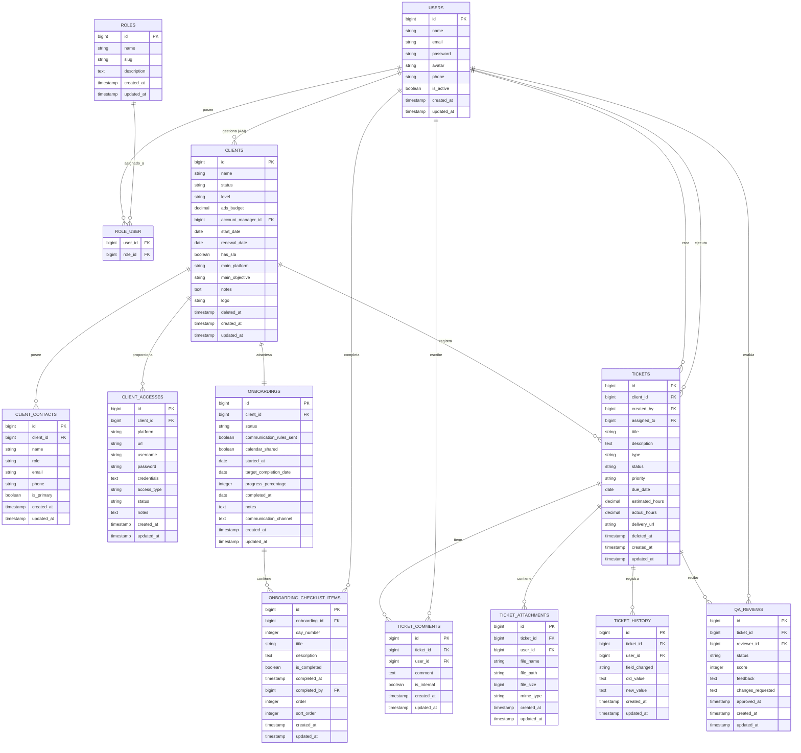
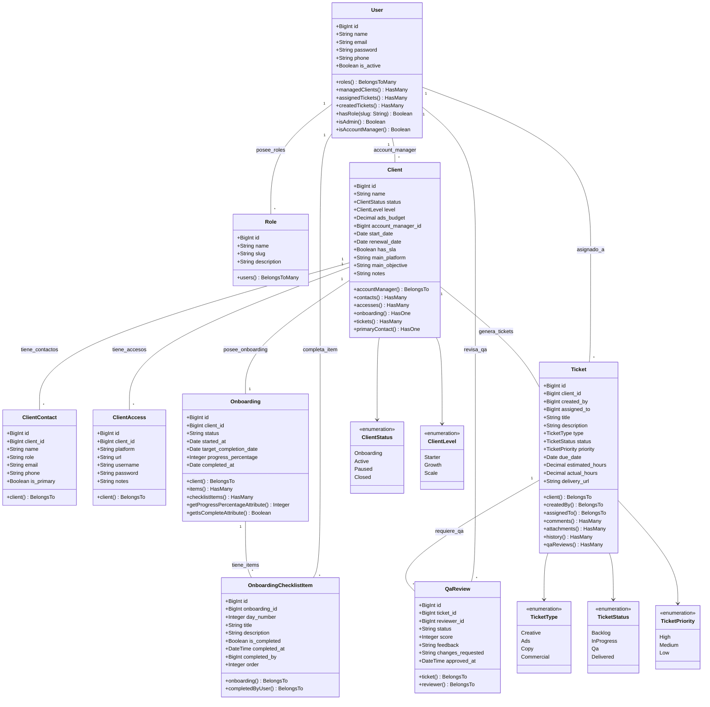
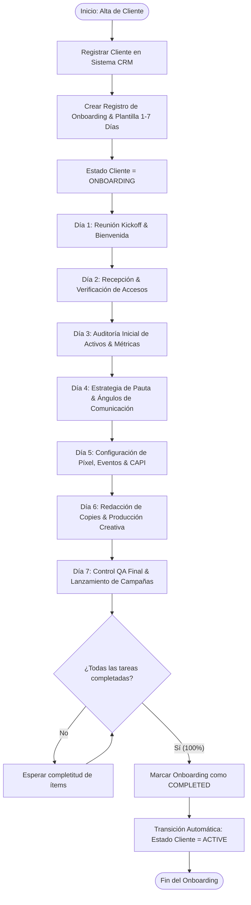
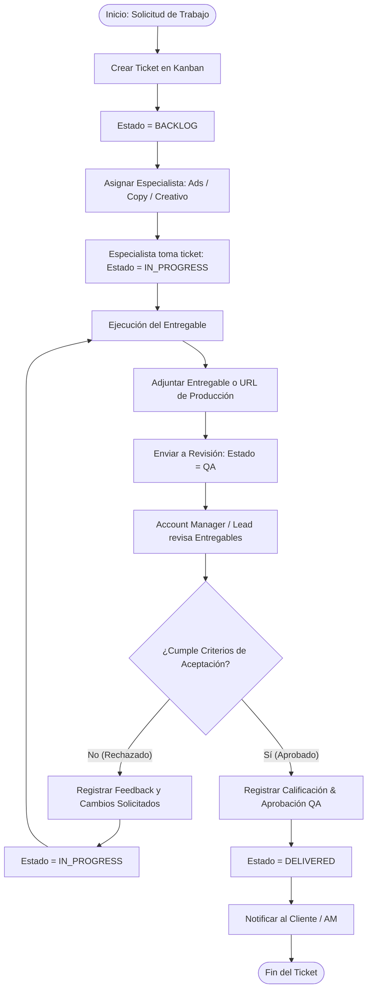

# Diagramas de Arquitectura — ShowFuture OS v1

Este documento contiene la especificación visual completa del sistema **ShowFuture OS v1**, dividida en tres secciones:
1. **Diagrama Entidad-Relación de la Base de Datos (BD)**
2. **Diagrama de Clases y Modelos (UML)**
3. **Diagramas de Procesos de Negocio (Workflows)**

---

## 1. Diagrama de la Base de Datos (ER Diagram)

El siguiente diagrama representa todas las tablas, llaves primarias (PK), llaves foráneas (FK), atributos y relaciones cardinales de la base de datos relacional.

---

## 2. Diagrama de Clases (UML Class Diagram)

Muestra los modelos de Eloquent, sus propiedades, métodos, Enums asociados y relaciones dentro del framework Laravel.

---

## 3. Diagramas de Procesos (Workflows)

### Proceso A: Onboarding Automatizado del Cliente (1–7 Días)

---

### Proceso B: Ciclo de Vida de Tickets y Control QA (Kanban)

